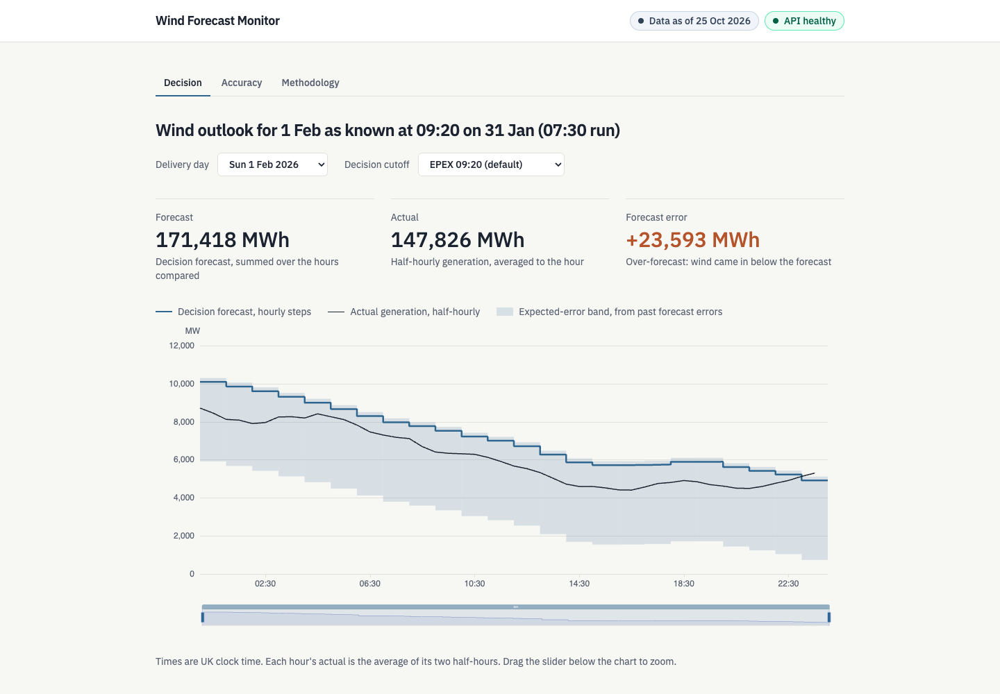

# Wind Forecast Monitor

A UK utility's day-ahead purchasing desk decides, at the decision cutoff on the decision day, how much national wind to rely on for the next day's delivery. This app shows the **decision snapshot**, the wind outlook as the desk saw it at that cutoff, against actual generation. It measures how accurate those forecasts were over the delivery days 2 Jan to 1 Feb 2026, and it shows an **expected-error band** built only from errors the desk already knew at the cutoff.



**Live app:** https://xkvq7m.vercel.app (Vercel Hobby, public)

The app has three views, all at the shared decision cutoff: **Decision** (one delivery day against its snapshot and band), **Accuracy** (headline metrics, band coverage, error histogram, error by horizon, error heatmap and worst days) and **Methodology** (how each figure is made, with the live alignment check).

## Quick start

Clone this repo, then from its root:

```sh
docker compose up        # builds the image and serves the app on http://localhost:8000
```

If the build stalls pulling the Dockerfile syntax image, use the legacy builder: `DOCKER_BUILDKIT=0 docker compose up --build`.

Without Docker you need uv, Python 3.12, pnpm and Node 22 (as in CI):

```sh
make install             # uv sync (backend) and pnpm install (frontend)
make dev                 # API on :8000 with reload, Vite on :5173
```

Open http://localhost:5173. Vite proxies `/api` to the API on :8000.

The DuckDB snapshot is committed at `data/snapshot.duckdb`, so the app runs without network access. `make ingest` refetches the window from Elexon and needs network.

| Command | What it does |
|---|---|
| `make install` | Install backend (uv) and frontend (pnpm) dependencies |
| `make dev` | Run the API on :8000 (reload) and the Vite dev server on :5173 |
| `make test` | Run all tests: pytest and Vitest |
| `make lint` | Run ruff, ruff format check, pyright, eslint and tsc |
| `make sensitivity` | Print the alignment sensitivity check at 09:20 |
| `make ingest` | Refetch Elexon and rebuild `data/snapshot.duckdb` (needs network) |
| `make gen-types` | Regenerate the OpenAPI document and the frontend API types |
| `make export-requirements` | Re-export `requirements.txt` for Vercel after a dependency change |

## Repo map

```
backend/                       FastAPI app, ingestion CLI, domain logic, tests (uv)
  app/main.py                  create_app(): mounts the API and, if set, the built frontend
  app/api/v1/                  endpoints: health, meta, decision-snapshot, accuracy
  app/api/problems.py          RFC 7807 problem responses for every route
  app/domain/                  pure logic, no SQL or HTTP: decision (cutoff and selection),
                               alignment, kpis, accuracy, band, error_grid, horizon
  app/ingestion/               make ingest: fetch, validate, deduplicate, write the snapshot
  app/repository/              the only code that reads the snapshot (read-only DuckDB)
  app/sensitivity.py           make sensitivity: the alignment check
  tests/                       api, domain, ingestion and repository tests; fixtures/elexon
                               holds recorded Elexon responses
frontend/                      React, TypeScript, Vite, TanStack Query, ECharts, Tailwind (pnpm)
  src/components/              DecisionView, AccuracyView, MethodologyView and their panels
  src/decision/                Decision view series, chart options, cutoff presets
  src/accuracy/                Accuracy view chart options
  src/api/                     generated types (openapi.json, schema.ts) and queries
  src/views/                   the ?view= tab logic
data/snapshot.duckdb           the committed snapshot the API reads
api/index.py                   the Vercel Python function that serves the API under /api
Dockerfile, docker-compose.yml multi-stage image: builds the frontend, serves it with FastAPI
vercel.json                    Vercel build settings and the /api rewrite
.github/workflows/ci.yml       CI: backend, frontend and Docker build jobs
docs/                          plan, research notes, ADRs, agent workflow docs
GLOSSARY.md                    domain terms, used in code, tests and UI text
```

## How it works

**Data.** Actual generation is Elexon's FUELHH series for national wind: half-hourly, in MW. Forecasts are Elexon's WINDFOR series: hourly target times, from eight runs a day, each stamped with its publish time. `make ingest` fetches WINDFOR publish times from 18 Dec 2025 and FUELHH settlement dates from 19 Dec 2025, to 1 Feb 2026. The December days are warm-up for the band. The API never calls Elexon.

The committed snapshot holds 26,864 forecast rows received. Of these, 5,521 were excluded because they were published after their target time. It has no malformed rows, no duplicates and no gaps. It also holds 2,160 half-hourly actuals.

**Decision cutoff and decision forecast.** A cutoff is a UK time on the decision day, the day before delivery. The default is 09:20, the EPEX auction. The picker also offers 09:50 (N2EX), 14:30 and 15:30 (half-hourly auctions), and any HH:MM time. For each target hour, the **decision forecast** is the latest forecast published at or before the cutoff. A forecast published after the cutoff is ignored. A target with no such forecast is a gap, and gaps are left out of the metrics. At 09:20 the decision forecasts come from the 07:30 run, with horizons of 16.5 to 39.5 hours.

**Hourly alignment.** Forecasts are hourly and actuals are half-hourly, so the actual for hour h is the mean of the half-hours starting at h:00 and h:30. If either half-hour is missing, the hour has no actual.

**Error and metrics.** Forecast error is forecast minus actual, in MW. A positive error means wind was over-forecast. The headline metrics are MAE, bias (the signed mean), RMSE, the P90 absolute error, and nMAE (MAE as a percentage of the mean actual). MAPE is not shown, because dividing by actual generation lets any hour with little wind dominate the figure. Excluded hours are counted by reason, so the counts add up to the target hours.

**Expected-error band.** For delivery day D, the band is the P10 and P90 of the hourly decision-forecast errors over the 14 delivery days from D-15 to D-2, at the same cutoff. The errors are pooled hour by hour. A day needs at least 7 past days with errors, or it gets no band. For a decision forecast F, the band for the actual is [F minus P90, F minus P10]. **Band coverage** is the share of counted hours whose actual fell inside its band. The target is about 80%.

The band is walk-forward. D-1 and later are never read, because the decision day is still in progress at the cutoff. Tests check this.

**Headline figures at 09:20.** From `GET /api/v1/accuracy?cutoff=09:20`, over 744 target hours of 2 Jan to 1 Feb 2026. All 744 hours are measured.

| Figure | Value |
|---|---|
| MAE | 2,038.9 MW |
| Bias | +1,747.9 MW (wind came in below the forecast on average) |
| RMSE | 2,504.8 MW |
| P90 absolute error | 4,097.9 MW |
| nMAE | 18.1% |
| Mean actual generation | 11,283.6 MW |
| Band coverage | 81.5% (606 of 744 hours inside the band) |

**Alignment sensitivity check.** The headline figures use the hourly mean. The check repeats them with the other rule, which compares each hour with the half-hour starting at h:00 alone. Both rules use the same decision forecasts. Run it with `make sensitivity`.

| Rule | Hourly mean (headline) | Top of hour | Difference |
|---|---|---|---|
| MAE | 2,038.9 | 2,022.5 | −16.4 |
| Bias | 1,747.9 | 1,745.9 | −1.9 |
| RMSE | 2,504.8 | 2,497.4 | −7.4 |

All figures are in MW, over the same 744 hours under both rules. The choice of alignment barely moves the figures: the MAE changes by under 1%.

## Testing and CI

`make test` runs 230 backend tests (pytest) and 123 frontend tests in 17 files (Vitest). `make lint` runs ruff, pyright, eslint and tsc.

What is tested:

- **Decision selection:** a forecast published exactly at the cutoff is used, one a minute later is not, a target with nothing published before the cutoff is a gap, and when several runs cover a target the latest before the cutoff wins. Each target uses the cutoff of its own delivery day. Clock-change days have 23 and 25 hours.
- **Alignment:** the hourly mean of two half-hours, a missing half-hour gives no actual, and the top-of-hour sensitivity rule.
- **Metrics:** values checked against hand-computed fixtures, P90 interpolation, nMAE with a zero mean, histogram edges and the closed last bin, and excluded hours counted by reason.
- **Band:** leakage (changing D-1 or any later day does not move the band), the 7-day minimum, inclusive band edges, pooled percentiles, and errors older than the lookback ignored.
- **Ingestion:** recorded Elexon responses with no network. Malformed rows, duplicates and excluded forecasts are counted, and a bad response leaves no snapshot behind.
- **API contract:** httpx against a fixture DuckDB, with RFC 7807 errors (422 for bad parameters, 503 when there is no snapshot).
- **Frontend:** Testing Library component tests for the views, the cutoff picker, the KPI tiles and the worst-days table, plus unit tests for the chart option builders.

Not covered: end-to-end tests, and there is no coverage target.

CI runs on GitHub Actions (`.github/workflows/ci.yml`) on every pull request and on pushes to `main`. It has three jobs: backend (ruff, pyright, pytest), frontend (eslint, tsc, Vitest) and a Docker build. There are no pre-commit hooks.

## Decisions

- [ADR-0001](docs/adr/0001-ingested-snapshot-not-live-proxy.md): serve from an ingested snapshot, not a live Elexon proxy
- [ADR-0002](docs/adr/0002-vercel-free-tier-docker-for-dev.md): Vercel's free tier for hosting, Docker for local dev and CI
- [ADR-0003](docs/adr/0003-duckdb-snapshot-store.md): DuckDB as the snapshot store
- [GLOSSARY.md](GLOSSARY.md): the domain terms
- [docs/plan.md](docs/plan.md): every agreed design decision and the build order
- [docs/research/elexon-and-market-facts.md](docs/research/elexon-and-market-facts.md): verified facts about the Elexon APIs, auction times and hosting limits

## AI assistance

Built with Claude Code (Anthropic) as an AI pair programmer for research, scaffolding, code and tests. I directed the design, reviewed every change, and own all decisions (see ADRs).

## Known limitations and next steps

- **Band shape:** the band is one P10 to P90 range for every hour. It is not conditioned on forecast level, which is the next step.
- **Snapshot, not a feed:** the data is a fixed window. A production version would run `make ingest` on a schedule over a rolling window instead (ADR-0001).
- **Monitoring:** there is no error monitoring. Sentry or a similar service is the next addition.
- **Scope:** the snapshot is a fixed window of delivery days 2 Jan to 1 Feb 2026, so it covers January 2026 only. It covers national wind only.
